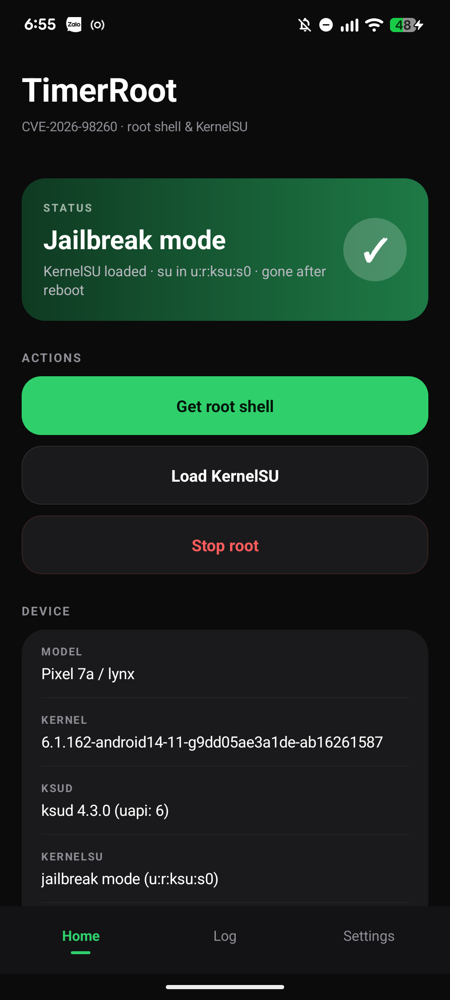

# TimerRoot

**Research use only.** Use it only on hardware you own or are explicitly
allowed to modify.

Android app for **CVE-2026-98260** (POSIX CPU timer use-after-free). One tap
gives a root shell in the shell domain, then late-loads **KernelSU**
(`u:r:ksu:s0`).

## Overview

TimerRoot wraps a conf-driven kernel exploit in an ordinary Android app. The
exploit is in `p7a/timer_p7a.c`; every kernel-specific constant lives in a
HOCON profile under `conf/`, selected at runtime from `uname -r` and the
userspace page size. The rest of the repository is the app shell around it:
UI, state detection, Shizuku plumbing and boot automation.

What it does:

- runs the exploit as the shell user through Shizuku, then keeps a `uid=0`
  shell open;
- late-loads KernelSU, KernelSU-Next or SukiSU Ultra, ending in
  `SELinux: Permissive` and `su` in `u:r:ksu:s0`;
- supports Samsung devices with a separate DEFEX/KDP chain pinned to the
  diabl0w/KernelSU Samsung build;
- can re-run the whole chain automatically on every real boot through a
  one-time localhost ADB channel;
- shows an optional boot status screen over the lock screen;
- checks GitHub for newer builds without installing anything by itself.

The exploit is tied to a kernel build, not a device name: a matching profile
must exist for the running kernel, and the app refuses to fall back to another
one.

## Documentation

| Guide | Contents |
|---|---|
| [Installation and usage](docs/installation.md) | Prerequisites, Shizuku setup, installing the exploit, first root, every screen and action, auto-root, Samsung mode, safety and troubleshooting |
| [Building](docs/building.md) | JDK/SDK/NDK requirements, Gradle and Gradle-free builds, signing, CI release workflow, adding profiles |
| [Supported devices](docs/supported-devices.md) | Manufacturer tables with build numbers, status legend and detailed per-family notes |
| [Auto-root research](docs/auto-root.md) | Design, Shizuku/ADB field notes, boot implementation and verified logs |
| [Contributions and credits](docs/contributions.md) | Every upstream project and per-device port this work took ideas from |
| [Port log](PORT_LOG.md) | Per-gate F1-F16 evidence for every bundled profile |
| [Porting skill](SKILL.md) | Procedure for deriving a profile for a new kernel |

Start with [Installation](docs/installation.md). It contains the 2-3 minute
post-boot wait, the Shizuku requirement, the matching-profile rule and the
one-shot-per-boot limits that matter before the first run.

## Safety

Do not kill a parked process, reboot to clear the root shell and KernelSU, and
remember that SELinux stays permissive until the next reboot. The full list is
in [Installation -> Safety](docs/installation.md#safety).

## License

MIT for the app code in this repository. The exploit binary and the Shizuku API
keep their own licenses; see [LICENSE](LICENSE) and
[Contributions](docs/contributions.md#license-notes).
